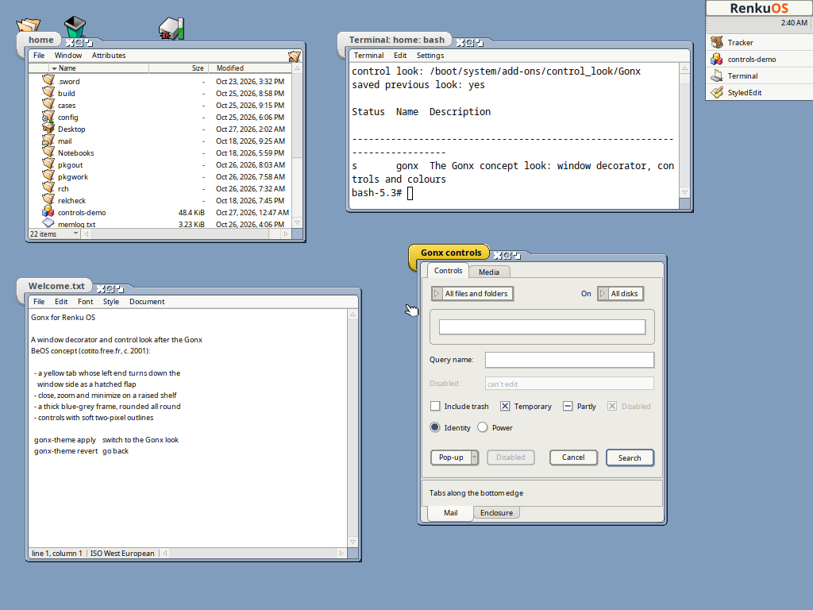

# Gonx for Renku OS and Haiku



The look of **Gonx**, a BeOS concept from around 2001 by Cotito
([archived site](https://web.archive.org/web/20141228160547/http://cotito.free.fr/projects/gonx+index.html),
[forum thread](https://discuss.haiku-os.org/t/ideas-for-haiku-r2-from-the-gonx-concept/8412)),
for [Renku OS](https://github.com/RenkuOS/Source) and Haiku: a window
decorator, a control look, desktop and system colours, and fonts.

Gonx was only artwork. This is a new implementation drawn to match the
screenshots; it contains no code from BeOS, Dano or Zeta.

## Install

Download `gonx-0.1.zip` from the
[releases](https://github.com/idumych/gonx/releases), unpack it, open a
Terminal in the `gonx-0.1` folder and run:

```sh
sh install.sh
```

If a compiler is installed, this builds Gonx against your own system first,
the safest way, since the decorator runs inside app_server. Without one it
uses the prebuilt files. To get the compiler:

```sh
pkgman install gcc make haiku_devel
sh install.sh --build
```

Everything goes into `~/config/non-packaged`; no package is installed.
Restart running applications, or log out and in, to get the new controls and
fonts everywhere.

```sh
gonx-theme revert      # your previous decorator, controls, colours and fonts
sh uninstall.sh        # revert and remove Gonx
```

If the desktop ever fails to start (for example after a system update), hold
Space while booting, open **Select safe mode options** and choose **Disable
user add-ons**. Once on the desktop, run `sh uninstall.sh`, or
`sh install.sh --build` to rebuild Gonx for the new system.

## What's here

- **Window decorator** (`add-ons/decorators/Gonx`):
  - A yellow tab (light grey when inactive) whose left end turns down the
    window's side as a hatched flap, ending in a rounded corner with a soft
    shadow.
  - Close, zoom and minimize sit together on a raised shelf right of the tab,
    which slopes down into a thick blue-grey top band.
  - The frame is lit from the top left and rounded at every corner, inside
    and out. A two-tone bracket in the bottom right corner marks where the
    window is resized.
- **Control look** (`add-ons/control_look/Gonx`):
  - Flat off-white buttons with an outline two pixels thick all round and a
    soft shadow: warm grey, or blue-grey on the default button. Text buttons
    are drawn at the concept's height.
  - Square menu fields, 19 pixels high, with the arrow in a grey segment on
    the left.
  - Outlined arrows, blue check marks, rounded tabs and group boxes, and
    pill-shaped scroll thumbs and slider knobs.
- **`gonx-theme`**:
  - `gonx-theme apply` switches to the decorator and the control look, and
    sets the blue-grey desktop (`#809DBD`), matching system colours, and fonts
    sized to the concept's text (Noto Sans 9 pt plain and menus, 11 pt bold).
  - `gonx-theme revert` puts back what you had before.
  - `gonx-theme status` shows what's active.

You can also pick either part alone in **Appearance → Look and feel**, or the
decorator with `setdecor Gonx`.

Still to come, from the same mockups: the desktop shell. That's the left
panel, the right sidebar (Help, News, Offline, Workspaces, Temp), the
top-right tray and clock, a bottom dock of running apps, and the radial
"Perso" folder menu.

## Credits

- **Concept and colours:** Cotito's Gonx mockups.
- **Tab and control shapes:** screenshots of Dano's Origin decorator. No Dano
  code was used.
- **Button glyphs:** the close, zoom and minimize glyphs, with their shadows
  and pressed states, are copied pixel for pixel from Momo's 2004 IceWM theme
  [Gonx](https://store.kde.org/p/1119093/). That theme was published without
  a licence statement.
- **Built with:** help from Claude, an AI assistant.

## Compatibility

The decorator is loaded into app_server and uses its private C++ classes,
and the control look builds on libbe's private `HaikuControlLook`. They only
use the decorator and control look interfaces, which have not changed from
Haiku R1/beta6 to current Renku. `build-headers/` holds the exact private
headers they need, so they can be built on any of those systems without a
source tree.

Known rough edges:

- **Open windows after a decorator switch:** windows that are already open
  keep square inner corners until they are resized or reopened, because
  `Window::ReloadDecor()` in app_server doesn't recompute the window's
  content region. A reboot clears it.
- **The flap's shadow:** it is painted over the Gonx desktop colour, since a
  decorator can't blend with what is behind the window. Over another window
  it shows as a thin dark edge.
- **Pop-up buttons:** they keep their arrow on the right, the only part of a
  `BButton` that opens its menu.

## Building

On Renku or Haiku, with `gcc`, `make` and `haiku_devel` installed:

```sh
make           # build/Gonx, build/control_look/Gonx, build/gonx-theme
make demo      # build/controls-demo: every control in one window
```

Cross-building on Linux uses the Haiku cross compiler from a configured
Renku source tree (`RENKU_SRC`, default `~/Projects/renku-src`), plus one
Renku machine over SSH. That machine supplies the libraries and `app_server`
and runs `rc`:

```sh
ssh <renku> pkgman install -y freetype_devel   # once
sh tools/sync-sysroot.sh <renku>                # once per Renku build
make RC_HOST=<renku>
sh packaging/zip/make-zip.sh 0.1                # dist/gonx-0.1.zip
make hpkg RC_HOST=<renku>                        # an .hpkg pinned to that build
```

## Tested

| System | Result |
|---|---|
| Renku x86_64, `r1~beta6_hrev60072_339` | Prebuilt, built on the system, and as an `.hpkg`. Decorator, buttons, dragging and resizing, every control in `controls-demo`, Appearance, menus, `gonx-theme apply`/`revert`, rebooting with Gonx active. |
| Haiku R1/beta6 x86_64, `hrev59866_92` | `install.sh` building on the system, `install.sh --prebuilt`, `uninstall.sh`. Decorator and controls draw correctly; app_server unaffected. |
| Stack & Tile, floating windows, fonts above 12 pt, dark colour schemes | Not tested yet |
| arm64 | Not built yet |

## License

MIT, see [LICENSE](LICENSE). The bundled headers in `build-headers/` keep
their own licences; see `build-headers/NOTICE`.
